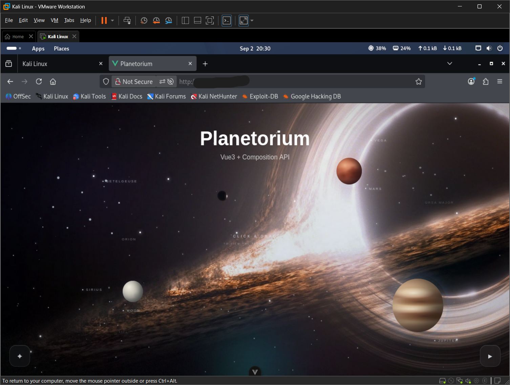

# Web Application Penetration Testing

An authorized web application security assessment of a Vue.js/Vite-based application, covering reconnaissance, manual security analysis, automated scanning, vulnerability assessment, production-build inspection, and remediation recommendations.

## Target

| Attribute | Details |
|---|---|
| Application | Planetorium |
| Environment | Authorized local development and production-preview environments |
| Technology | Vue.js + Vite |
| Testing Platform | Kali Linux |
| Authorization | Explicit permission from the application owner |

## Target Application

---

## Table of Contents

- [Project Overview](#project-overview)
- [Objectives](#objectives)
- [Methodology](#methodology)
- [Testing Scope](#testing-scope)
- [Tools](#tools)
- [Testing Progress](#testing-progress)
- [Security Assessment Summary](#security-assessment-summary)
- [Documentation](#documentation)
- [Evidence](#evidence)
- [Authorization](#authorization)

---

## Project Overview

This project documents a hands-on penetration testing assessment performed against an authorized Planetorium web application.

The assessment combines manual security analysis with industry-standard reconnaissance and web application security tools.

The objective was to identify potential security weaknesses, inspect application behavior, validate scanner observations, document evidence, and provide appropriate remediation recommendations.

Testing covered both the Vite development environment and a separately generated production build.

## Objectives

- Identify exposed services and application technologies.
- Analyze HTTP requests, responses, and browser behavior.
- Inspect application resources and development endpoints.
- Assess security headers and browser security configurations.
- Analyze application traffic using Burp Suite.
- Perform automated security scanning using OWASP ZAP.
- Investigate potential information disclosure.
- Perform initial input-handling and XSS checks.
- Assess production-build resource exposure.
- Validate and document security observations.
- Provide remediation recommendations.
- Prepare a final penetration testing report.

---

## Methodology

The assessment followed a structured workflow:

**Reconnaissance → Testing → Evidence Collection → Verification → Impact Assessment → Findings Documentation → Remediation Recommendations**

Automated scanner alerts were manually reviewed. Observations were not automatically classified as confirmed vulnerabilities.

---

## Testing Scope

### In Scope

- Network and service reconnaissance.
- Web technology fingerprinting.
- HTTP requests and responses.
- Browser network activity.
- Client-side resources.
- Vue/Vite development resources.
- WebSocket traffic.
- Security headers.
- CORS behavior.
- Information disclosure.
- Initial input validation and XSS checks.
- Production-build assessment.

### Not Applicable / Not Performed

Based on the functionality identified during inspection:

- Authentication testing: No application authentication functionality identified.
- Authorization testing: No protected application functionality identified.
- API security testing: No conventional backend API communication identified in the inspected source.
- CSRF testing: No relevant state-changing application functionality identified.
- Post-remediation retesting: Not performed because application-side fixes were not implemented.

### Out of Scope

- Unauthorized systems and third-party applications.
- Denial-of-service testing.
- Destructive testing.
- Social engineering.
- Physical security testing.
- Third-party infrastructure.

---

## Tools

| Tool | Purpose |
|---|---|
| Nmap | Network and service reconnaissance |
| WhatWeb | Web technology fingerprinting |
| Wappalyzer | Application technology identification |
| curl | HTTP request and response analysis |
| Firefox Developer Tools | Browser and network analysis |
| Burp Suite | HTTP interception and manual testing |
| OWASP ZAP | Automated security scanning and alert analysis |
| PowerShell | Application source inspection |
| Git and GitHub | Version control and documentation |

---

## Testing Progress

| Phase | Status |
|---|---|
| Project Scope and Authorization | Completed |
| Nmap Reconnaissance | Completed |
| WhatWeb Fingerprinting | Completed |
| Wappalyzer Technology Detection | Completed |
| HTTP and Browser Analysis | Completed |
| Vue/Vite Source Inspection | Completed |
| Burp Suite Testing | Completed |
| OWASP ZAP Passive Scanning | Completed |
| OWASP ZAP Active Scanning | Completed |
| Endpoint and Source Discovery | Initial Checks Completed |
| Authentication Assessment | Not Applicable to Identified Functionality |
| Authorization Assessment | Not Applicable to Identified Functionality |
| Session and Browser Storage Analysis | Initial Checks Completed |
| Input Validation and XSS | Limited Checks Completed; No Vulnerability Confirmed |
| API Security Assessment | Not Applicable to Identified Architecture |
| CSRF Assessment | Not Applicable to Identified Functionality |
| Production Build Assessment | Completed |
| Production Resource Exposure Checks | Completed for Selected Paths |
| Findings Documentation | Completed |
| Remediation Recommendations | Documented |
| Application-Side Remediation | Not Implemented |
| Post-Remediation Retesting | Not Performed |
| Final Report | Prepared |
| GitHub Documentation and Cleanup | Final Review Pending |

---

## Security Assessment Summary

### 1. Security Header Observations

Three missing security headers were observed in the inspected Vite production-preview response:

- `Content-Security-Policy`
- `X-Frame-Options`
- `X-Content-Type-Options`

These are documented as security configuration and hardening observations. Their final severity depends on the actual production deployment and application requirements.

### 2. Development Resource Exposure

Development resources and transformed Vue source files were accessible through the Vite development server.

The inspected production preview returned the application HTML fallback for selected development-resource paths.

No standalone source-map files were found in the production build.

### 3. XSS Assessment

Initial XSS checks were performed.

No XSS vulnerability was confirmed during the limited testing performed.

### 4. Automated Scanning

OWASP ZAP identified security-header observations and informational alerts.

The Dev Standard active scan completed with:

- 4,970 requests.
- 100% completion.
- Zero new active-scan alerts.

Scanner-generated false positives and informational observations were manually reviewed.

### 5. Overall Assessment

No confirmed exploitable application vulnerability was established through the documented testing.

The assessment identified security hardening opportunities and development-environment information exposure.

---

## Documentation

### Reconnaissance

Initial reconnaissance covering Nmap, WhatWeb, and Wappalyzer.

[View Reconnaissance Documentation](reconnaissance/README.md)

### Web Application Testing

Manual HTTP, browser, source-resource, and production-preview analysis.

[View Web Testing Documentation](web-testing/README.md)

### Burp Suite

HTTP interception, Repeater, Site Map, HTTP method testing, and WebSocket analysis.

[View Burp Suite Documentation](burp-suite/README.md)

### OWASP ZAP

Passive scanning, active scanning, manual alert validation, and false-positive identification.

[View OWASP ZAP Documentation](owasp-zap/README.md)

### Security Findings

Consolidated security observations, evidence references, impact assessment, and validation status.

[View Security Findings](findings/findings.md)

### Remediation

Recommended security configuration improvements and remediation guidance.

[View Remediation Recommendations](remediation/fixes.md)

### Final Report

Complete penetration testing assessment, results, limitations, and conclusion.

[View Final Report](reports/final-report.md)

---

## Evidence

Screenshots and testing evidence are organized within their respective testing directories.

### Reconnaissance Evidence

- Nmap
- WhatWeb
- Wappalyzer
- Target application overview

[View Reconnaissance Evidence](reconnaissance/README.md)

### Web Testing Evidence

- HTTP response analysis
- Browser Developer Tools
- Vue/Vite source inspection
- Browser network and session analysis
- Production security-header assessment

[View Web Testing Evidence](web-testing/README.md)

### Burp Suite Evidence

- HTTP History
- Repeater
- HTTP method testing
- Site Map
- WebSocket analysis

[View Burp Suite Evidence](burp-suite/README.md)

### OWASP ZAP Evidence

- Passive scan alerts
- Active scan results
- Manual alert validation
- False-positive analysis

[View OWASP ZAP Evidence](owasp-zap/README.md)

All public evidence must be sanitized to remove local IP addresses, usernames, filesystem paths, tokens, and other sensitive information.

---

## Remediation Status

Remediation recommendations have been documented.

Application-side fixes were not implemented or verified as part of this assessment.

Post-remediation retesting was not performed.

The recommendations are provided for consideration by the application owner.

---

## Authorization

Testing was performed with explicit permission from the application owner against the authorized Planetorium application.

The assessment was limited to the defined scope and did not intentionally target unauthorized systems or third-party infrastructure.

---

## Disclaimer

This repository is intended for educational and cybersecurity portfolio purposes.

All testing was performed within the authorized scope. Scanner alerts and security observations should not automatically be interpreted as confirmed vulnerabilities.

**Project Status: Security Assessment and Documentation Completed.**