# OWASP ZAP Testing

## Overview

OWASP ZAP was used to perform automated and passive security analysis of the authorized Planetorium web application.

Testing included:

- Passive security analysis
- HTTP request and response inspection
- WebSocket traffic analysis
- Active vulnerability scanning
- Manual validation of scanner findings
- False-positive identification

## Target

| Attribute | Details |
|---|---|
| Application | Planetorium |
| Environment | Local development environment |
| Technology | Vue.js / Vite |
| Authorization | Testing performed with explicit authorization from the application owner |

Sensitive local IP addresses, tokens, filesystem paths, and other identifying information are redacted from public evidence.

## Testing Configuration

| Setting | Value |
|---|---|
| Tool | OWASP ZAP 2.17.0 |
| Mode | Standard Mode |
| Scan Type | Active and Passive |
| Active Scan Policy | Dev Standard |
| Recurse | Enabled |
| Target | Authorized local development instance |

## Passive Scan Findings

ZAP identified several security-header-related findings and informational alerts.

| Finding | ZAP Risk | Assessment |
|---|---|---|
| Content Security Policy (CSP) Header Not Set | Medium | Security hardening observation |
| Missing Anti-clickjacking Header | Medium | Security hardening observation |
| X-Content-Type-Options Header Missing (Systemic) | Low | Security hardening observation |
| Information Disclosure - Information in Browser localStorage | Informational | Not confirmed as a vulnerability |
| Information Disclosure - Sensitive Information in URL | Informational | Vite HMR development token; not confirmed as sensitive application data |
| Information Disclosure - Suspicious Comments | Informational | Development/dependency comments; not confirmed as a vulnerability |
| Modern Web Application | Informational | Technology/behavior observation |
| Base64 Disclosure in WebSocket Message | Informational | Development-server behavior; not confirmed as a vulnerability |
| Email Address Found in WebSocket Message | Informational | False positive |

### Security Header Findings

The following missing security headers were observed:

- `Content-Security-Policy`
- `X-Frame-Options` or equivalent anti-clickjacking protection
- `X-Content-Type-Options`

These observations are documented as security hardening issues.

Because the target was running through a Vite development server, these findings must not automatically be classified as production vulnerabilities. Their actual severity depends on the intended deployment environment and security impact.

## Active Scan

An initial scan using the default policy generated a large number of requests and was stopped because of its resource-intensive nature.

A subsequent scan was performed using the lighter **Dev Standard** policy.

### Active Scan Results

| Metric | Result |
|---|---|
| Scan completion | 100% |
| Requests | 4,970 |
| Current scans | 0 |
| New active-scan alerts | 0 |

The completed Dev Standard scan did not identify additional active-scan alerts.

This result does not establish that the application is free from all vulnerabilities. Automated scanning has limitations, particularly for application-specific logic and authorization issues.

## Manual Validation

Automated scanner results were manually reviewed before being considered security findings.

### 1. Base64 Disclosure in WebSocket Message

ZAP detected Base64-encoded content in WebSocket traffic.

Manual inspection showed that the decoded content was associated with a Vite development/import-analysis error message rather than credentials, session tokens, cookies, or other application secrets.

**Assessment:** Informational development-server behavior. Not treated as a confirmed vulnerability.

### 2. Email Address Found in WebSocket Message

ZAP reported an email address in WebSocket traffic.

Manual inspection showed that the detected pattern was:

`@keyframes`

This is CSS syntax and not an email address.

**Assessment:** False positive.

### 3. Sensitive Information in URL

ZAP detected a `token` parameter in a URL.

The request was associated with the Vite Hot Module Replacement (HMR) WebSocket mechanism, identified through the `vite-hmr` WebSocket protocol.

The observed token was therefore treated as a development-server HMR token rather than an application authentication or session token.

**Assessment:** Informational development-server observation. Not treated as a confirmed vulnerability.

### 4. Suspicious Comments

ZAP detected comments in application and dependency JavaScript resources.

Manual review showed that these were normal source-code, dependency, and development comments. No exposed credentials or security secrets were confirmed.

**Assessment:** Informational. Not treated as a confirmed vulnerability.

### 5. Browser Local Storage Information

ZAP reported information stored in browser Local Storage.

Manual inspection identified Vue DevTools interface preferences rather than application authentication credentials or session tokens.

**Assessment:** Informational development-tool behavior. Not treated as a confirmed vulnerability.

## Evidence

### 1. Passive Scan Evidence

#### Passive Alerts Overview

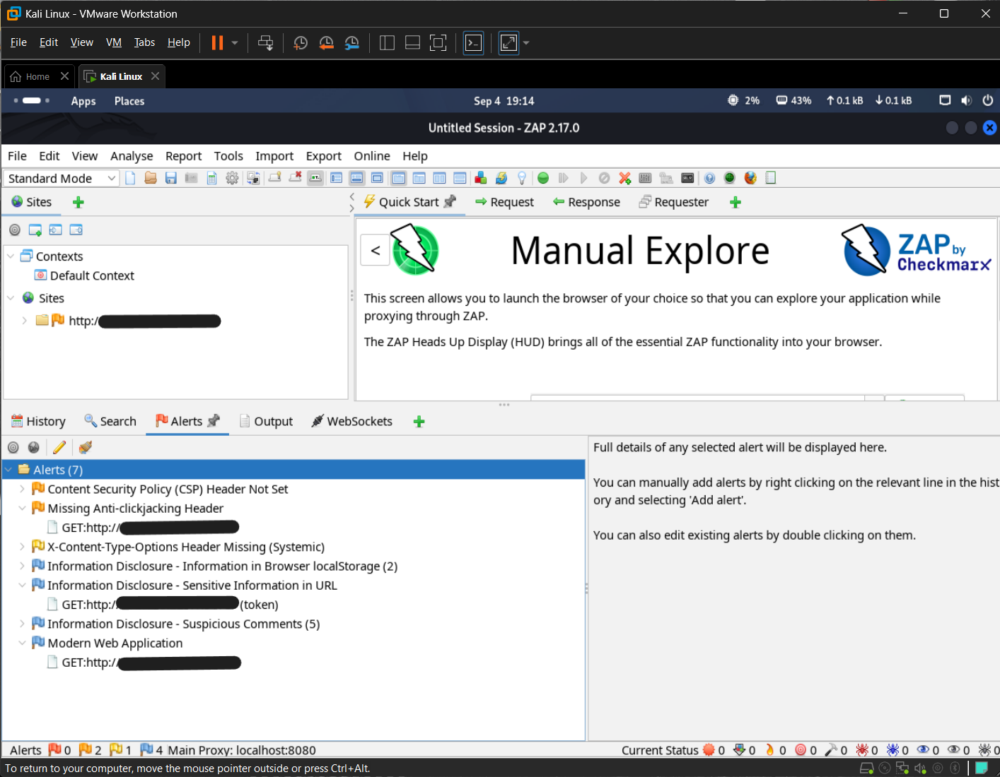

#### Content Security Policy Header Not Set

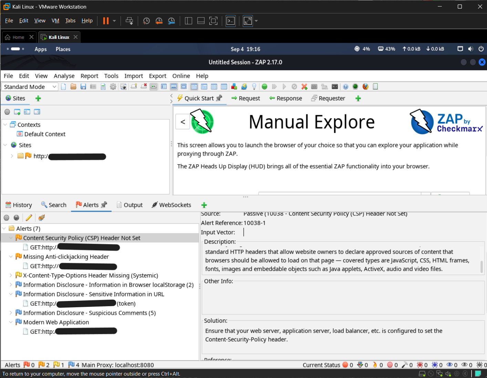

#### Missing Anti-clickjacking Header

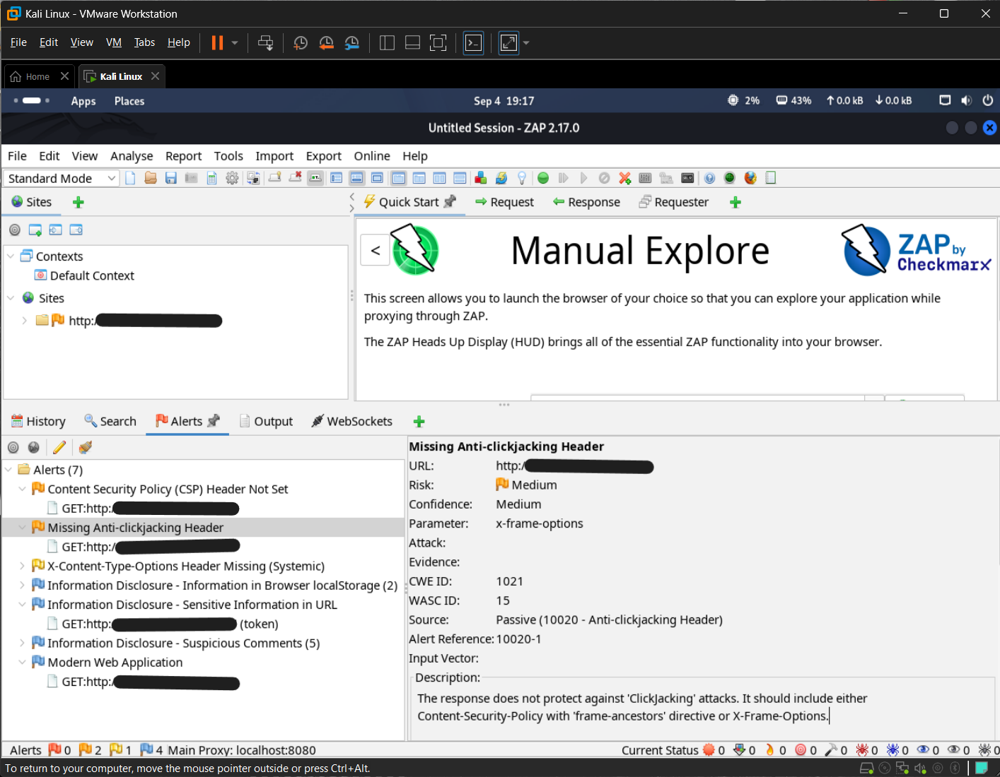

#### X-Content-Type-Options Header Missing

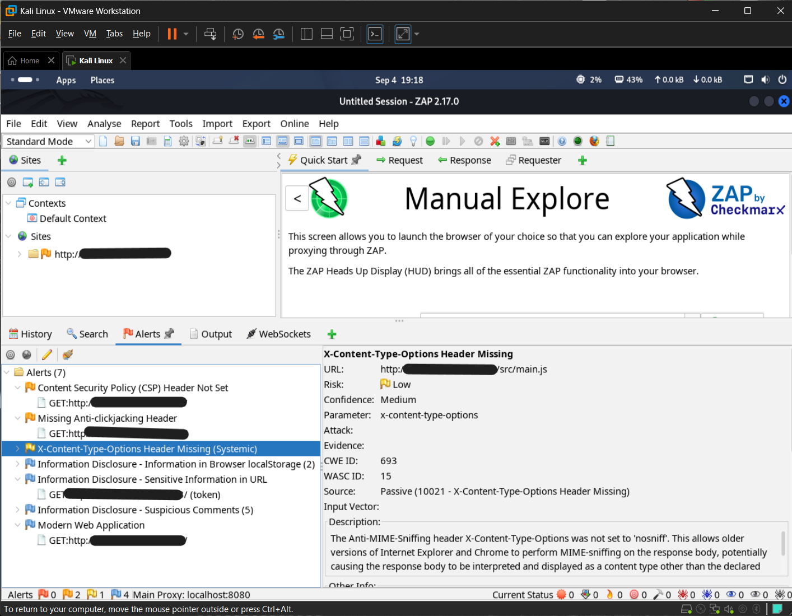

#### Sensitive Information in URL

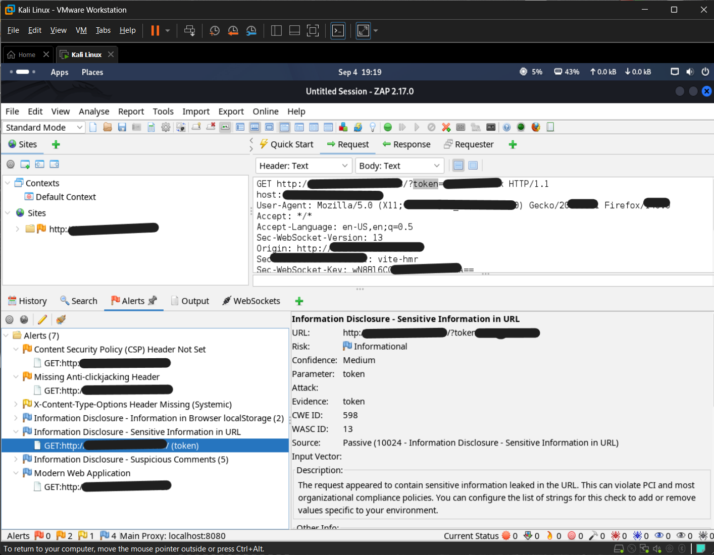

### 2. Active Scan Evidence

#### Active Scan Configuration

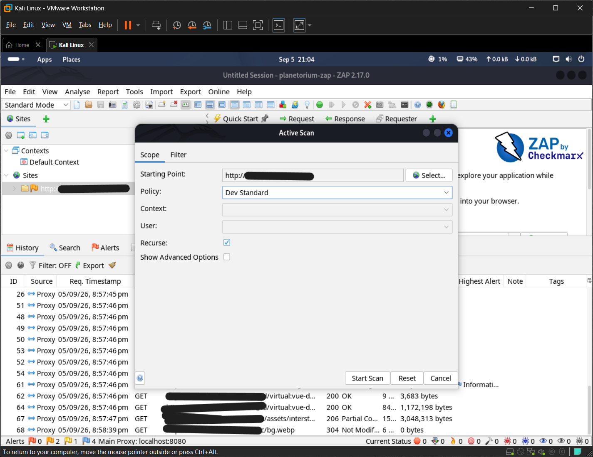

#### Active Scan Completed

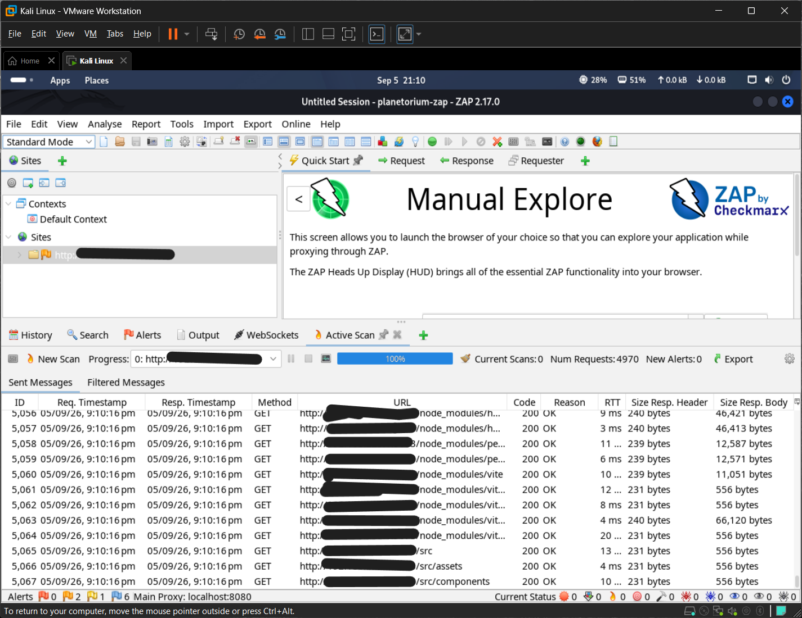

#### Final ZAP Alerts Overview

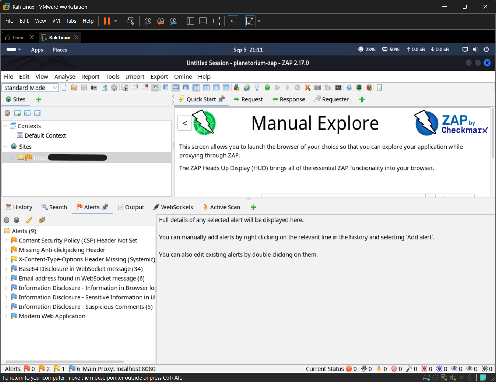

### 3. Manual Validation Evidence

#### Base64 WebSocket Analysis

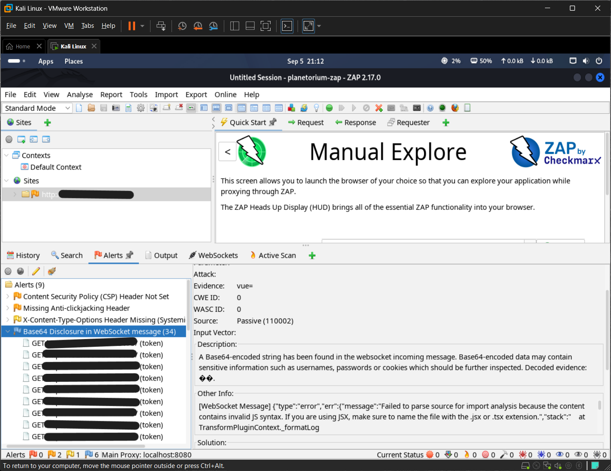

#### Email False Positive

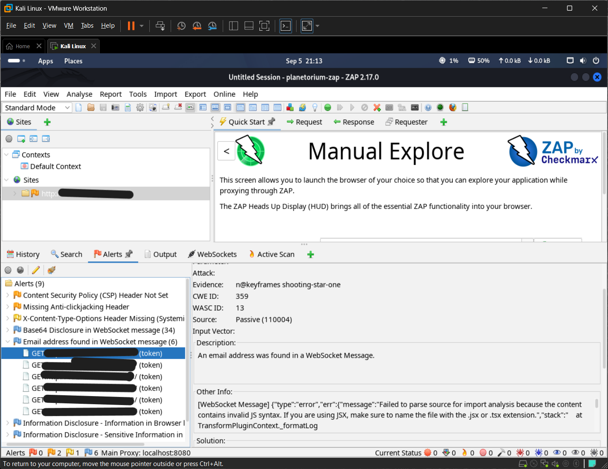

#### Sensitive URL Analysis

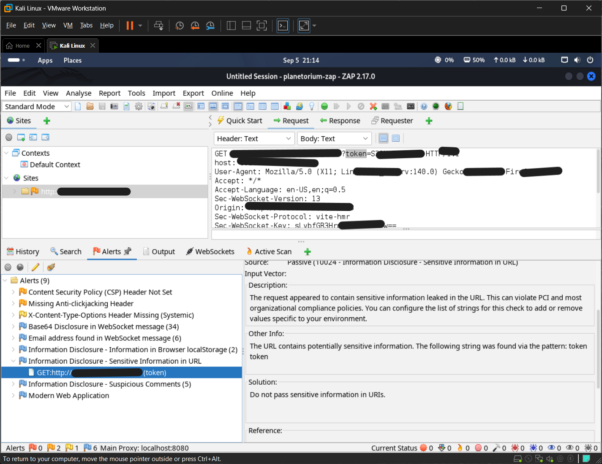

## Key Takeaways

- Passive analysis identified three missing browser security headers.
- Active scanning using the Dev Standard policy completed successfully.
- A total of 4,970 requests were generated during the completed active scan.
- No new active-scan alerts were identified.
- Informational findings were manually reviewed.
- Scanner-generated false positives were identified and excluded from confirmed vulnerabilities.
- The Vite HMR token was distinguished from application authentication credentials.
- Development-server behavior was separated from application-level security findings.
- No confirmed exploitable vulnerability was established through the ZAP testing documented here.

## Assessment Limitations

- Testing was performed with authorization from the application owner.
- The target was running in a local Vue/Vite development environment.
- Development-server behavior may differ from production behavior.
- Automated scanning cannot identify every application-specific vulnerability.
- The completed active scan does not replace manual authorization, business-logic, or input-validation testing.
- Findings require deployment-context assessment before final severity classification.
- Evidence screenshots must not expose private IP addresses, tokens, usernames, filesystem paths, or other sensitive information.

## Status

**OWASP ZAP Testing: Completed**

- [x] Passive security analysis
- [x] HTTP request and response inspection
- [x] WebSocket traffic analysis
- [x] Active scanning using Dev Standard policy
- [x] Manual alert validation
- [x] False-positive identification
- [x] Evidence collection
- [x] ZAP documentation

**Next Project Phases:**

- Findings validation and consolidation
- Authorization testing applicability assessment
- CSRF testing applicability assessment
- API security assessment applicability
- Remediation documentation
- Retesting
- Final penetration testing report
- GitHub documentation and cleanup