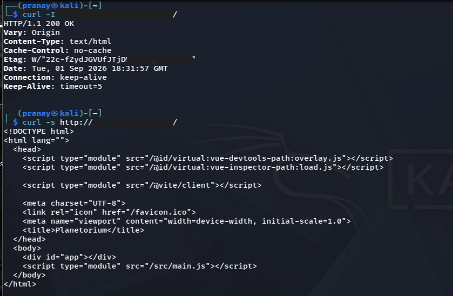
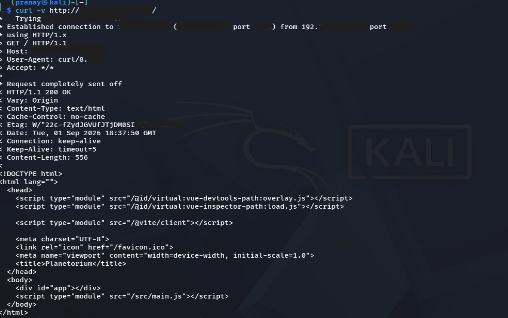
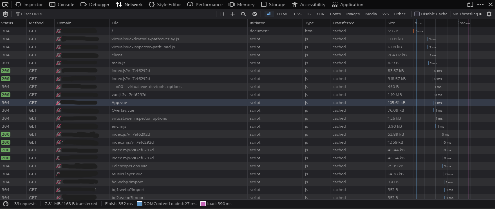
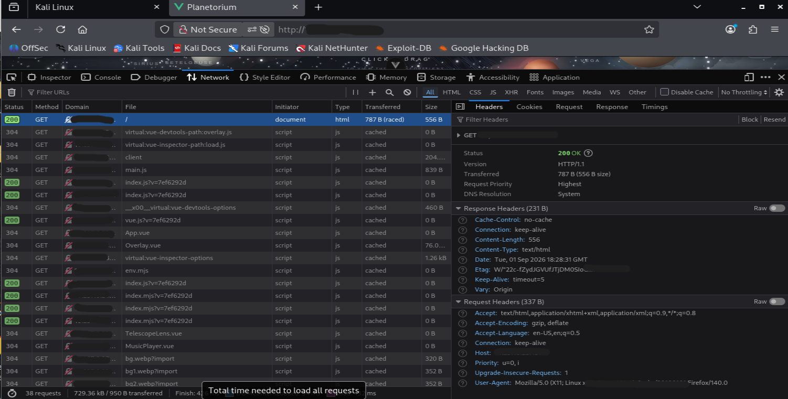
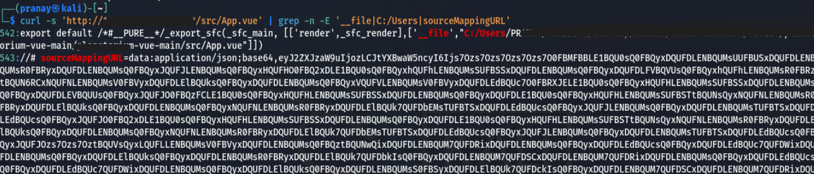
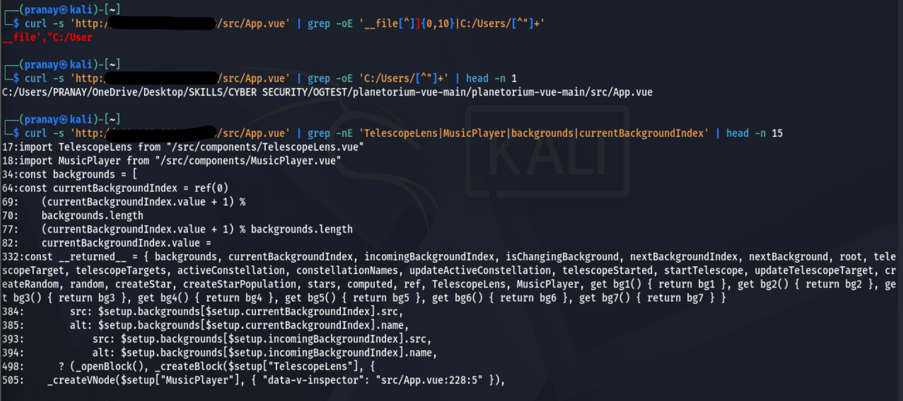
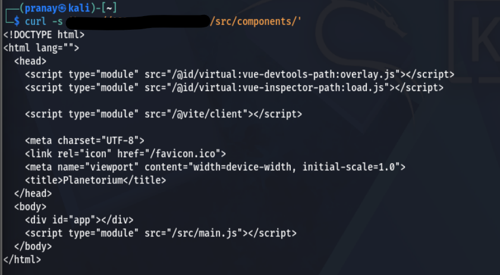
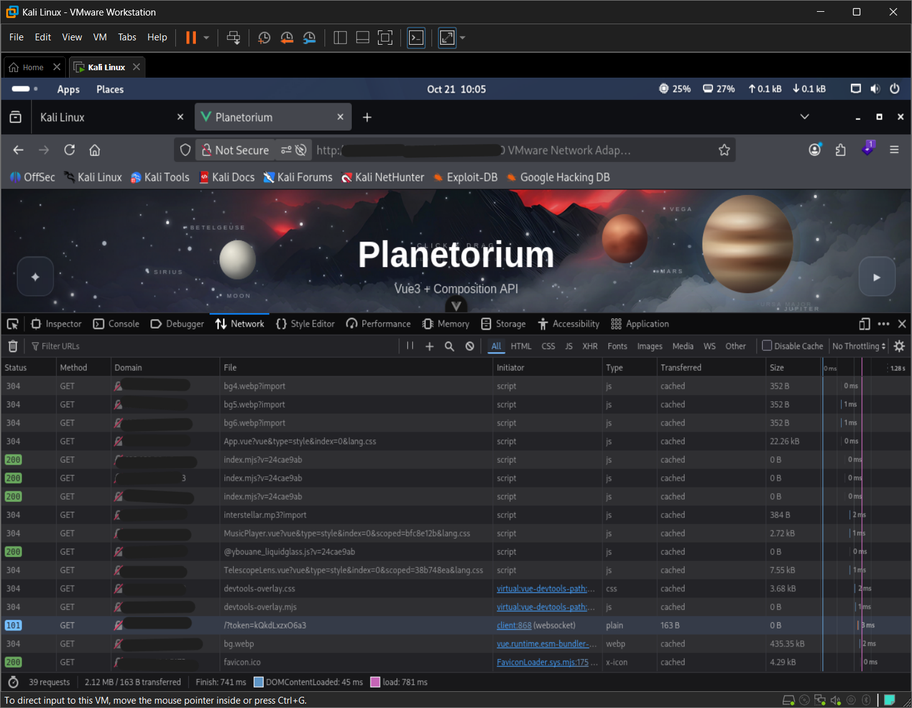

# Web Application Testing

Manual HTTP and browser-based security analysis of the authorized Planetorium web application.

## Scope

Testing focused on HTTP behavior, response headers, browser network activity, JavaScript resources, and Vue/Vite development-server behavior.

## HTTP Analysis

### curl

Used `curl` to inspect HTTP responses, headers, and supported request methods.

Tests performed:
- HTTP response analysis
- GET request analysis
- Verbose HTTP request/response inspection
- Response header inspection
- OPTIONS request analysis
- Selected resource accessibility checks

Key observations:
- The application returned `HTTP 200 OK` for the main page.
- The response used `Content-Type: text/html`.
- `Cache-Control: no-cache` and `ETag` headers were present.
- `Vary: Origin` was present.
- An OPTIONS request returned `204 No Content`.
- The OPTIONS response advertised supported HTTP methods.
- The tested preflight response did not explicitly allow the supplied origin.

The OPTIONS response alone does not establish a CORS vulnerability.

## Browser DevTools Analysis

Firefox Developer Tools were used to inspect:

- Network requests and response status codes
- HTTP request and response headers
- JavaScript resources
- Vue and Vite development resources
- Application initialization
- Browser requests made while loading the application

The observed resources were consistent with a Vue application served through Vite development tooling.

## Vue/Vite Source Inspection

Selected application resources were inspected to understand the exposed development environment.

Observations:
- `/src/main.js` returned JavaScript.
- `/src/App.vue` returned transformed Vue component code.
- `/package.json` returned application dependency and script metadata.
- `/vite.config.js` returned transformed Vite configuration code.
- The Vue response included local filesystem path metadata.
- The transformed resources contained inline source-map data.
- `/src/components/` returned the application HTML page rather than a directory listing.

These observations indicate development-resource exposure. They do not independently establish a production vulnerability.

## Security Header Assessment

The main HTTP response was checked for common security headers.

The observed response did not include:
- `Content-Security-Policy`
- `X-Frame-Options`
- `X-Content-Type-Options`

These observations are consistent with the findings identified during OWASP ZAP passive scanning.

Because the target was running through a Vite development server, the missing headers are documented as observations requiring deployment-context assessment, rather than automatically classified as production vulnerabilities.

## Evidence

### 1. Initial HTTP Response

### 2. Verbose HTTP Analysis

### 3. Browser Network Analysis

### 4. HTTP Headers in Browser DevTools

### 5. Vue Source Metadata

### 6. Vue Source Path Confirmation

### 7. Vue Component Discovery

### 8. Components Directory Check

### Browser Network and Session Analysis

**Observations:**
- Vue/Vite development resources loaded successfully in the displayed requests.
- HTTP `200`, `304`, and `101` responses were observed.
- The `101` response corresponded to the Vite development WebSocket connection.
- No application authentication or login functionality was identified.
- Cookies, Session Storage, and IndexedDB contained no entries during inspection.
- Local Storage contained Vue DevTools interface preferences.

**Assessment:** No authentication or session-management vulnerability was established by these checks. The observed Local Storage entries were development-tool preferences, not identified authentication credentials.

## Assessment Notes

- The target was tested with authorization from its owner.
- The application was running in a Vite development environment.
- Development-server behavior must be distinguished from production behavior.
- HTTP status codes and exposed resources are not automatically vulnerabilities.
- CORS behavior must be evaluated using the complete response and browser-enforced policy.
- Potential findings require manual verification and impact assessment.
- Screenshots and published evidence must not expose private filesystem paths, usernames, tokens, or other sensitive information.

## Status

- [x] HTTP response analysis
- [x] GET and OPTIONS request analysis
- [x] HTTP request and response header inspection
- [x] Browser Network analysis
- [x] JavaScript resource identification
- [x] Vue/Vite development-resource inspection
- [x] Selected endpoint accessibility checks
- [x] Initial security header assessment
- [x] Evidence collection

**Phase status:** Completed — initial HTTP and browser-based analysis.

**Note:** This phase does not represent completion of the overall penetration test. Authentication, authorization, input validation, vulnerability validation, remediation, and retesting are tracked separately.